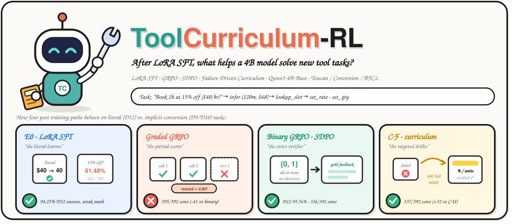

**English** | [中文](README_zh.md)

# tool-curriculum-rl

<p align="center">
  
</p>

**From `Qwen3-4B-Base` to a tool-calling model: a controlled D1–D12 study of LoRA SFT, GRPO (binary vs. graded), SDPO, and failure-driven self-curriculum.**

This project investigates a concrete question: once a 4B base model learns how to invoke tools via schema-guided LoRA SFT, what actually helps it solve **new** tasks later: scalar RL (GRPO), richer teacher error feedback (SDPO), or generating its own training tasks from past failures (`C-F`)?

All experiments (D1–D12) were run on single-GPU RTX PRO 6000 nodes with fixed seeds/data splits, paired statistical tests, and a sealed 3,018-task final evaluation ([full research report in Chinese](docs/FINAL_REPORT.md)).

---

## Key Takeaways

1. **LoRA SFT drives the main leap (`14.98%` → `94.25%` on unseen tool families).**
   - `Qwen3-4B-Base` with 3-shot prompting (`B0`) only passes refusal tasks on unseen families (`276/1842`).
   - Naive SFT initially scored `0` strict tool accuracy with `100%` truncation because 6 boundary/protocol special tokens in the tied embedding table started with identical vectors (cosine similarity `1.000`). Re-initializing and unfreezing those 6 rows produced `E0` (`1736/1842` strict greedy on unseen families, `96.63%` `pass@8`), beating official `Qwen3-4B-Instruct` (`B1`: `1684/1842`, `93.00%` `pass@8`) on this protocol.
2. **On literal parameter-extraction tasks (`D12`), post-SFT RL only shifts a few tasks.**
   - `E0` already solves `1510/1582` (`95.45%`) of 0-call and 1-call unseen tasks.
   - `D9 Binary GRPO` reaches the highest overall strict greedy score (`2890/3018`, `95.76%`; unseen `1741/1842`, `+5` dual-call tasks over `E0`), and `E2b-gold-only` / `D8 C-F` tie for highest unseen `pass@8` (`96.80%` strict, `96.96%` default-equivalent). After Holm correction across the 20-model comparison, none of the post-SFT D12 differences are statistically significant.
3. **Implicit parameter conversion (`D9/D10`) separates methods sharply.**
   - When identical gold tool calls are phrased indirectly (requiring unit, percentage, quantity, relative time, or discount calculations instead of copying literals), `E0` drops from `392/392` (Literal) to `241/392` (`61.48%`).
   - Under a matched 692-task pool (`30` steps), **Targeted SFT** recovers `+110` (`351/392`, `89.54%`) and **Binary GRPO** recovers `+95` (`336/392`, `85.71%`). **Graded GRPO** (`295/392`, `75.26%`) trails Binary GRPO by `41` tasks (`38` on `rate_total` items) due to partial-reward farming (`0.80` for calling the right tools without finishing the unit conversion).
4. **Failure-driven self-curriculum (`C-F`) beats uniform self-generation (`C-U`) by `+8.16 pp` under equal budgets (`D10`).**
   - With identical generation attempts (`1,200`), mixed-difficulty filter (`360` tasks), and training steps (`30`), `C-F` reaches `337/392` (`85.97%`) vs. `C-U` `305/392` (`77.81%`, `32` wins / `0` losses, Holm `p = 4.66e-10`) and static review `C-S` `250/392` (`63.78%`). All `360` tasks entering `C-F` training are genuine conversion tasks (vs. `232/360` in `C-U`). However, this conversion gain does not transfer to the literal D12 sealed set (`1732/1842`) or BFCL (`1046/1240`).
5. **SDPO feedback & refusal replay matter in specific regimes.**
   - Disabling same-group success demonstrations in SDPO (`E2b-gold-only`) increases environment feedback coverage (`2.81% → 13.85%`), raising BFCL (`1050 → 1056`) and unseen dual-call / `pass@8` (`96.80%`).
   - Training a self-curriculum purely on tool-calling tasks (`D7 C-F`) degrades refusal (`258/276` unseen greedy; BFCL irrelevance `181 → 143/240`), whereas mixing ~15% refusal replay at lower LR (`D8 C-F`) restores refusal to `276/276` while keeping multi-call gains.

---

## Summary Results

### 1. Sealed D12 Evaluation & External BFCL (Strict Greedy unless noted)

| Model | D12 All `/3018` | D12 Unseen `/1842` | Unseen Refusal `/276` | Unseen Dual-Call `/150` | Unseen `pass@8` `/1842` | BFCL `/1240` |
|---|---:|---:|---:|---:|---:|---:|
| `B0 · Qwen3-4B-Base (3-shot)` | 452 (14.98%) | 276 (14.98%) | 276 | 0 | — | — |
| `B1 · Qwen3-4B-Instruct` | 2773 (91.88%) | 1684 (91.42%) | 271 | 140 | 1713 (93.00%) | 1149 |
| `E0 · LoRA SFT` | 2881 (95.46%) | 1736 (94.25%) | 276 | 137 | 1780 (96.63%) | 1058 |
| `E1 · Binary GRPO` | — | 1734 (94.14%) | 276 | 142 | 1781 (96.69%) | 1049 |
| `E2b-gold-only · SDPO` | — | 1736 (94.25%) | 276 | 142 | **1783 (96.80%)** | 1056 |
| `D8 C-F · Curriculum + Replay` | — | 1734 (94.14%) | 276 | 141 | **1783 (96.80%)** | — |
| `D9 Binary GRPO` | **2890 (95.76%)** | **1741 (94.52%)** | 276 | **142** | 1781 (96.69%) | **1072** |
| `D10 C-F · Failure Curriculum` | 2874 (95.23%) | 1732 (94.03%) | 276 | 138 | 1779 (96.58%) | 1046 |

### 2. Unseen-Domain Implicit Conversion Holdout (392 Literal / Conversion Pairs)

| Experiment & Arm | Literal `/392` | Conversion `/392` | vs. `E0` | `rate_total` `/112` | BFCL `/1240` |
|---|---:|---:|---:|---:|---:|
| **D9** · `E0` | 392 | 241 (61.48%) | — | 19 | 1056 |
| **D9** · `Targeted SFT` | 392 | **351 (89.54%)** | +110 | **79** | 1058 |
| **D9** · `Binary GRPO` | 392 | 336 (85.71%) | +95 | 64 | **1072** |
| **D9** · `Graded GRPO` | 392 | 295 (75.26%) | +54 | 26 | 1052 |
| **D10** · `E0` | 392 | 240 (61.22%) | — | 18 | 1060 |
| **D10** · `C-S` (Static Review) | 392 | 250 (63.78%) | +10 | 19 | 1053 |
| **D10** · `C-U` (Uniform Gen) | 392 | 305 (77.81%) | +65 | 41 | 1049 |
| **D10** · `C-F` (Failure-Driven) | 392 | **337 (85.97%)** | **+97** | **67** | 1046 |

---

## Repository Structure

```text
.
├── docs/
│   ├── FINAL_REPORT.md            # Complete D1–D12 technical report (Chinese)
│   ├── PLAN.md                    # Original research plan
│   ├── PROGRESS.md                # Milestone log
│   └── experiment_cards/          # Per-stage experiment cards (d1_smoke .. d12_final)
├── scripts/
│   ├── autodl/                    # Training & eval launchers (d1..d12, d12_models.tsv, SHA-256 locks)
│   ├── d7_review_seed.py          # Curriculum candidate review helper
│   ├── probe_teacher.py           # SDPO teacher logprob/feedback diagnostic
│   └── repartition_gold.py        # Gold-call-key disjoint split builder
├── src/tcrl/
│   ├── data/                      # Dataset cleaning, family splitting, conversion synthesis
│   ├── sft/                       # LoRA SFT + special token initialization fixes
│   ├── curriculum/                # Seed selection, candidate generation, verifier & pass@8 filtering
│   ├── eval/                      # D12 sealed evaluator, BFCL runner, bootstrap/McNemar stats
│   ├── prompts.py                 # Prompt formatting & `<think>` prefix protocol
│   ├── reward.py                  # Core call-set matching & default-value equivalence
│   ├── tool_env.py                # Deterministic schema/argument checker
│   └── verl_reward*.py            # GRPO / D9 / Graded reward functions for verl
└── tests/                         # Unit tests for rewards, schema checking, splits, and stats
```

> **Note:** Local `runs/`, `data/raw/`, and `data/processed/` directories are excluded via `.gitignore`. All experiment cards in `docs/experiment_cards/` record exact run IDs, hyperparameters, metrics, and SHA-256 archive hashes.

---

## Running Local Tests

Requires Python `>= 3.10` (`pyproject.toml` configures `pythonpath = ["src"]` and `testpaths = ["tests"]`):

```bash
pip install -e .
pytest
```

## Documentation Index

- **Final Report:** [docs/FINAL_REPORT.md](docs/FINAL_REPORT.md)
- **Base, Data & SFT (`D1–D3`):** [d1_smoke.md](docs/experiment_cards/d1_smoke.md) · [d2_data.md](docs/experiment_cards/d2_data.md) · [d3_sft_probe.md](docs/experiment_cards/d3_sft_probe.md) · [d3_gold_disjoint.md](docs/experiment_cards/d3_gold_disjoint.md) · [d3_p0_targeted.md](docs/experiment_cards/d3_p0_targeted.md)
- **GRPO, SDPO & Original-Distribution Curriculum (`D4–D8`):** [d4_grpo_targeted.md](docs/experiment_cards/d4_grpo_targeted.md) · [d5_e0plus_targeted.md](docs/experiment_cards/d5_e0plus_targeted.md) · [d6_sdpo_targeted.md](docs/experiment_cards/d6_sdpo_targeted.md) · [d7_curriculum_bfcl.md](docs/experiment_cards/d7_curriculum_bfcl.md)
- **Implicit Conversion & Curriculum (`D9–D10`):** [d9_thinking_conversion.md](docs/experiment_cards/d9_thinking_conversion.md) · [d10_curriculum.md](docs/experiment_cards/d10_curriculum.md)
- **Sealed Final Evaluation (`D12`):** [d12_final.md](docs/experiment_cards/d12_final.md)
