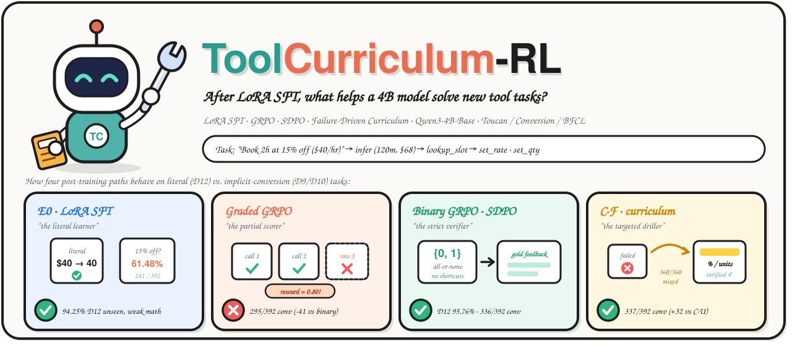

[English](README.md) | **中文**

# tool-curriculum-rl

<p align="center">
  
</p>

**从 `Qwen3-4B-Base` 到可用工具调用模型：关于 LoRA SFT、GRPO（二值 vs 分级）、SDPO 与失败驱动自生成课程（D1–D12）的系统实验仓库。**

本项目围绕一个具体问题展开：当 4B 基座模型通过 LoRA SFT 学会按 schema 调用工具之后，继续做标量强化学习（GRPO）、引入教师错误反馈（SDPO），或让模型基于自身失败样本自生成训练题（失败驱动课程 `C-F`），哪一种方法还能进一步提升未见工具域的泛化表现。

全部 D1–D12 实验均在单卡 RTX PRO 6000 上完成，固定数据划分与随机种子，配套成对统计检验及 3,018 题封存终评。完整技术细节见 [最终研究报告](docs/FINAL_REPORT.md)。

---

## 核心结论

1. **最大的一步提升来自 SFT（未见工具族准确率 `14.98%` → `94.25%`）。**
   - `Qwen3-4B-Base` 加 3-shot 示例（`B0`）在未见工具族上只会做拒答题（`276/1842`）。
   - 最初直接做 SFT 严格分为 `0`、截断率 `100%`。排查后发现基座输入/输出词表共享权重，其中 6 个控制对话和工具协议的特殊 token 初始向量余弦相似度全是 `1.000`，LoRA 默认冻住它们导致模型无法稳定闭合输出。重新初始化并放开训练这 6 行后，得到的 `E0` 在未见工具族达到 `1736/1842`（`94.25%`，`pass@8` `96.63%`），超过官方 `Qwen3-4B-Instruct`（`B1`：`1684/1842`，`pass@8` `93.00%`）。
2. **在原分布“直接抽取参数”的封存集（D12，3,018 题）上，SFT 之后各种后训练方法几乎拉不开统计差距。**
   - `E0` 在 0 次与 1 次调用上已经做对 `1510/1582`（`95.45%`），剩下空间主要在少量双调用与 3+ 次调用。
   - `D9 Binary GRPO` 拿到全量严格 greedy 最高分 `2890/3018`（`95.76%`；未见族 `1741/1842`，双调用比 `E0` 多对 5 题）；`E2b-gold-only` 与 `D8 C-F` 并列未见族 `pass@8` 最高（`96.80%` 严格 / `96.96%` 默认值等价）。但在 20 组 Holm 校正后，SFT 之后的差异均未达到统计显著。
3. **一旦题目需要“先做隐式换算再填参数”（D9/D10 留出集，392 对），各方法立刻拉开明显差距。**
   - 同一套调用需求，参数直接写在题面里（Literal）时 `E0` 是 `392/392`；换成百分比、单位、相对时间、单价或折扣表达（Conversion）后，`E0` 直接掉到 `241/392`（`61.48%`）。
   - 在完全对齐的 692 题池和 30 步预算下，**Targeted SFT** 救回 `+110` 题（`351/392`，`89.54%`），**Binary GRPO** 救回 `+95` 题（`336/392`，`85.71%`）；而看似信息更细的 **Graded GRPO**（`295/392`，`75.26%`）反而比二值少对 41 题（其中 38 题出现在含单价总额 `rate_total` 的题上），原因在于部分正确奖励（`0.60`/`0.80`）纵容了“调对工具但没算完单价”的局部刷分。
4. **同预算下，失败驱动出题 `C-F` 比均匀出题 `C-U` 在换算题上多对 32 题（`+8.16 pp`）。**
   - D10 中 `C-F` 与 `C-U` 各生成尝试 `1,200` 次、各筛出 `360` 道混合难度题训练 `30` 步：最终 `C-F` 达到 `337/392`（`85.97%`），`C-U` 为 `305/392`（`77.81%`），逐题配对 **`32` 胜 `0` 负**（Holm `p = 4.66e-10`），静态复习 `C-S` 只有 `250/392`（`63.78%`）。`C-F` 的 360 道入训题全部是隐式换算题（`C-U` 为 `232/360`）。不过这项能力迁移并未同步提升 D12 原分布封存集（`1732/1842`）或 BFCL（`1046/1240`）。
5. **SDPO 与拒答回放的关键细节。**
   - SDPO 中关闭同组成功轨迹示范（`E2b-gold-only`）后，含标准答案的环境纠错覆盖率从 `2.81%` 升到 `13.85%`，带来 BFCL（`1050 → 1056`）及 D12 未见族双调用与 `pass@8`（`96.80%`）的提升。
   - 课程若只练调用题不练拒答（`D7 C-F`），会把未见族拒答率从 `276/276` 打掉到 `258/276`（BFCL irrelevance `181 → 143/240`）；加入约 15% 拒答回放并下调学习率（`D8 C-F`）即可完整恢复拒答（`276/276`）并保留多调用收益。

---

## 核心实验数据总览

### 1. D12 原分布封存终评与外部 BFCL（未标注均为严格 greedy）

| 模型 | 全量 `/3018` | 未见族 `/1842` | 未见族拒答 `/276` | 未见族双调用 `/150` | 未见族 `pass@8` `/1842` | BFCL `/1240` |
|---|---:|---:|---:|---:|---:|---:|
| `B0 · Qwen3-4B-Base (3-shot)` | 452 (14.98%) | 276 (14.98%) | 276 | 0 | — | — |
| `B1 · Qwen3-4B-Instruct` | 2773 (91.88%) | 1684 (91.42%) | 271 | 140 | 1713 (93.00%) | 1149 |
| `E0 · LoRA SFT` | 2881 (95.46%) | 1736 (94.25%) | 276 | 137 | 1780 (96.63%) | 1058 |
| `E1 · Binary GRPO` | — | 1734 (94.14%) | 276 | 142 | 1781 (96.69%) | 1049 |
| `E2b-gold-only · SDPO` | — | 1736 (94.25%) | 276 | 142 | **1783 (96.80%)** | 1056 |
| `D8 C-F · 课程 + 拒答回放` | — | 1734 (94.14%) | 276 | 141 | **1783 (96.80%)** | — |
| `D9 Binary GRPO` | **2890 (95.76%)** | **1741 (94.52%)** | 276 | **142** | 1781 (96.69%) | **1072** |
| `D10 C-F · 失败驱动课程` | 2874 (95.23%) | 1732 (94.03%) | 276 | 138 | 1779 (96.58%) | 1046 |

### 2. 未见域隐式换算留出集（392 对 Literal / Conversion）

| 实验与组别 | Literal `/392` | Conversion `/392` | 相对 `E0` 净增 | 含 `rate_total` `/112` | BFCL `/1240` |
|---|---:|---:|---:|---:|---:|
| **D9** · `E0` | 392 | 241 (61.48%) | — | 19 | 1056 |
| **D9** · `Targeted SFT` | 392 | **351 (89.54%)** | +110 | **79** | 1058 |
| **D9** · `Binary GRPO` | 392 | 336 (85.71%) | +95 | 64 | **1072** |
| **D9** · `Graded GRPO` | 392 | 295 (75.26%) | +54 | 26 | 1052 |
| **D10** · `E0` | 392 | 240 (61.22%) | — | 18 | 1060 |
| **D10** · `C-S`（静态复习） | 392 | 250 (63.78%) | +10 | 19 | 1053 |
| **D10** · `C-U`（均匀生成） | 392 | 305 (77.81%) | +65 | 41 | 1049 |
| **D10** · `C-F`（失败驱动） | 392 | **337 (85.97%)** | **+97** | **67** | 1046 |

---

## 仓库目录说明

```text
.
├── docs/
│   ├── FINAL_REPORT.md            # D1–D12 完整研究报告
│   ├── PLAN.md                    # 初始研究计划
│   ├── PROGRESS.md                # 阶段进度日志
│   └── experiment_cards/          # 各阶段实验卡（d1_smoke .. d12_final）
├── scripts/
│   ├── autodl/                    # AutoDL 训练与评测脚本（d1..d12、d12_models.tsv、SHA-256 锁定）
│   ├── d7_review_seed.py          # 课程候选抽检辅助脚本
│   ├── probe_teacher.py           # SDPO 教师端 logprob / 反馈诊断脚本
│   └── repartition_gold.py        # 按标准调用键重新划分 SFT/RL 池
├── src/tcrl/
│   ├── data/                      # 数据清洗、工具族切分、隐式换算题合成
│   ├── sft/                       # LoRA SFT 与特殊 token 初始化修复
│   ├── curriculum/                # 失败种子筛选、题干生成、确定性验题与 pass@8 过滤
│   ├── eval/                      # D12 封存评测、BFCL 评测、bootstrap / McNemar 统计
│   ├── prompts.py                 # 对话模板与 `<think>` 空前缀协议
│   ├── reward.py                  # 调用集合匹配与默认值等价判定
│   ├── tool_env.py                # 确定性 schema 与参数校验器
│   └── verl_reward*.py            # verl 使用的二值 / D9 / 分级奖励函数
└── tests/                         # 奖励、校验、划分与统计的本地单测
```

> **说明：** 本地 `runs/`、`data/raw/` 与 `data/processed/` 已通过 `.gitignore` 排除在 Git 之外；各阶段完整 run ID、超参数与归档 SHA-256 均记录在 `docs/experiment_cards/` 中。

---

## 本地测试与文档导航

需要 Python `>= 3.10`（`pyproject.toml` 已配置 `pythonpath = ["src"]` 与 `testpaths = ["tests"]`）：

```bash
pip install -e .
pytest
```

- **研究总报告：** [docs/FINAL_REPORT.md](docs/FINAL_REPORT.md)
- **底座、数据与 E0（`D1–D3`）：** [d1_smoke.md](docs/experiment_cards/d1_smoke.md) · [d2_data.md](docs/experiment_cards/d2_data.md) · [d3_sft_probe.md](docs/experiment_cards/d3_sft_probe.md) · [d3_gold_disjoint.md](docs/experiment_cards/d3_gold_disjoint.md) · [d3_p0_targeted.md](docs/experiment_cards/d3_p0_targeted.md)
- **原分布后训练与 SDPO（`D4–D8`）：** [d4_grpo_targeted.md](docs/experiment_cards/d4_grpo_targeted.md) · [d5_e0plus_targeted.md](docs/experiment_cards/d5_e0plus_targeted.md) · [d6_sdpo_targeted.md](docs/experiment_cards/d6_sdpo_targeted.md) · [d7_curriculum_bfcl.md](docs/experiment_cards/d7_curriculum_bfcl.md)
- **隐式换算与课程对比（`D9–D10`）：** [d9_thinking_conversion.md](docs/experiment_cards/d9_thinking_conversion.md) · [d10_curriculum.md](docs/experiment_cards/d10_curriculum.md)
- **封存终评（`D12`）：** [d12_final.md](docs/experiment_cards/d12_final.md)
