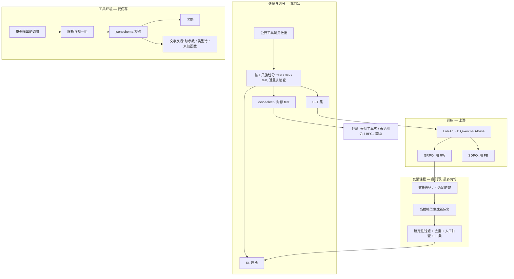

# ToolCurriculum-RL v0：从 Base 模型到工具调用的后训练流水线与反馈课程

> 版本：2026-11-12 v0（规划草稿，**待用户确认**；标「待确认」的条目确认后写入 CLAUDE.md「已定决策」）
> 定位：第三个项目，与 StatefulSearch-RL（主）互补。约 14 个项目工作日。
> 状态：**尚未运行任何实验。本文不包含任何预期数字**；所有结果位在实验完成后由日志回填。
> 项目名与目录名是工作名，可改。

---

## 0. 一页纸总结

| 项 | 内容 |
|---|---|
| 一句话 | 把 Qwen3-4B-**Base** 经 SFT → RL 训练成工具调用模型，并回答：**等总成本下，由模型自己的失败驱动的自生成课程，能否比静态数据更好地泛化到没见过的工具？** |
| 主体（约 80%） | 完整后训练流水线：数据构造与划分 → LoRA SFT → 可验证奖励的 RL（GRPO，以及富反馈自蒸馏 SDPO 作为对照臂）→ 封存评测 |
| RSI 成分（约 15–20%，最多两轮） | 反馈驱动的迭代课程：当前模型在自己答错 / 不确定的题上生成新任务，经确定性校验过滤后进入下一轮训练 |
| 底座 | veRL 系（首选 `lasgroup/SDPO`：基于较新 veRL，同时带 GRPO 与 SDPO；退路为现有 veRL 0.7 镜像 + 只做 GRPO） |
| 思想来源 | ToolRL（奖励设计）、Tool-R0（工具调用自博弈课程）、R-Zero（按不确定性出题）、SDPO（把环境的文字反馈变成稠密信号）、Synthesize-and-Reward（分级有效性奖励） |
| 你自己的东西 | ① 按工具族隔离的数据划分与可执行校验环境；② 奖励函数及其反例测试；③ 等成本的三臂课程对照与逐轮伪标签审计；④ Base→SFT→RL 各阶段贡献的拆解 |
| 算力 | AutoDL RTX PRO 6000 96GB，LoRA，每组 1 卡、多组并行（沿用主项目做法） |
| 交付 | 可复现仓库 + 流水线各阶段结果 + 课程三臂对照 + 封存测试 + 报告 + 真实数字的简历 bullet |

---

## 1. 为什么是这个项目

### 1.1 与前两个项目的互补
- 主项目只做了 RL，起点是官方 Instruct 模型，研究的是 Agent 的上下文管理。它没有覆盖「从 Base 模型做 SFT」「SFT 数据怎么构造」「SFT 与 RL 各贡献多少」这些后训练岗位面试的常规问题。
- 本项目补上这一段：从 Base 模型出发，完整走一遍数据 → SFT → RL → 评测。
- 工具调用与主项目的搜索 Agent 属于同一条能力线（Agent 用工具），但研究对象不同：主项目研究「拿到工具结果后怎么管理上下文」，本项目研究「调用能力本身怎么训出来」。

### 1.2 这条流水线有没有较新的底座或思想可借（2026-11-12 调研结论）
流水线本身（Base → SFT → GRPO）是通用做法，没有一个「拿来就是新东西」的底座。可借的新东西有这些：

| 工作 | 时间 | 可借的部分 | 代码状态（2026-11-12 核对） |
|---|---|---|---|
| **SDPO**（Reinforcement Learning via Self-Distillation，ICML 2026） | 2026-01 | 模型看到环境反馈后充当自己的老师，把修正后的 token 分布蒸馏回策略。工具调用的报错信息（缺参数、类型不对、函数不存在）正是它需要的文字反馈 | `lasgroup/SDPO` 已开源，veRL 0.7.0.dev；**自带 ToolAlpaca 工具调用任务和 GRPO 基线**；有 LoRA 配置，老师也会挂 LoRA（见 `docs/notes/d1_base_survey.md`） |
| **ToolRL**（NeurIPS 2025） | 2025-04 | 工具调用奖励的分解方式（格式 + 正确性，粒度与尺度的消融结论） | `qiancheng0/ToolRL` 已开源，但依赖太旧不支持 Qwen3，只参考奖励文件 `rlla.py` |
| **Tool-R0** | 2026-02 | Generator–Solver 自博弈课程用于工具调用；课程动力学分析 | 仓库 `emrecanacikgoz/Tool-R0` 有完整流程代码（trl + peft，非 veRL，按 3–4 卡写）；过滤与归一化实现可对照 |
| **Synthesize and Reward**（IBM） | 2026-06 | 分级有效性奖励（函数名存在 → 参数类型正确 → 执行成功）；他们用 veRL + GRPO 训了 Qwen3-4B | 论文写「即将发布」，未核实到已发布 |
| **Fission-GRPO** | 2026-01 | 把执行失败的轨迹变成新的训练样本 | 未核对 |
| **Toucan**（EMNLP 2026） | 2025–2026 | 150 万条来自真实 MCP 工具的轨迹，比 xlam-60k 新、覆盖并行与多步调用 | 数据集公开，D1 核对许可与格式 |
| 工具调用评测有效性审计（arXiv 2607.02577）、PostTrainBench v1.2 | 2026 | BFCL 题目错误率高、对实现细节敏感，不能单独作为结论依据 | — |

**据此的设计选择（待确认）**：
1. 底座首选 `lasgroup/SDPO`。它本身是 veRL 的分支，GRPO 基线和 SDPO 都在里面，一个底座同时支撑两条 RL 对照臂。D1 做 Go/No-Go。
2. RL 阶段做「标量奖励 GRPO vs 富反馈 SDPO」的对照。SDPO 原论文已在 ToolAlpaca 上做过工具调用（Qwen3-8B，测试集 68 条），所以这不是首次；我们的增量是：从 Base 经 SFT 起步、4B + LoRA、按工具族隔离的更大评测集、以及回应「小模型上 SDPO 是否只是记忆」的争议（SDPO issue #26）。
3. SFT 数据优先用 Toucan 的单轮 / 并行子集，xlam-60k 作备选。

### 1.3 「自己的东西」边界
| 来自上游 | 我们自己做的 |
|---|---|
| veRL 训练器、GRPO、SDPO 损失、vLLM 推理 | 工具调用环境：schema 校验、调用归一化、文字反馈生成 |
| 公开工具调用数据（Toucan / xlam） | 按工具族隔离的 train / dev / test 划分与近重复检查 |
| ToolRL 的奖励分解思路 | 奖励函数实现及反例测试（错参数、漏调用、多调用、类型错） |
| Tool-R0 / R-Zero 的课程思想 | 失败驱动的任务生成、确定性过滤、等成本三臂对照、逐轮伪标签审计 |

**面试话术原则**：说「流水线是通用做法，课程思想借鉴 Tool-R0；我做的是受控对照和归因」，不说「提出了自进化框架」。RSI 部分称「反馈驱动的迭代课程自训练」。

---

## 2. 研究问题

- **RQ1（各阶段贡献）**：Base（few-shot）→ SFT → SFT+RL，每一步在「未见工具族」上各带来多少？与官方 Qwen3-4B-Instruct 相比处于什么位置？
- **RQ2（RL 信号形式）**：相同 rollout 预算下，标量奖励 GRPO 与富反馈自蒸馏 SDPO 在工具调用上谁更有效？差别出在哪类错误（格式 / 选错工具 / 参数值）？
- **RQ3（反馈课程）**：等总成本（含生成与过滤的 GPU 时间）下，失败驱动的自生成课程（F）相对静态数据续训（S）和无引导生成（U），在未见工具与未见工具组合上是否更好？
- **RQ4（多轮动力学）**：两轮课程中，伪标签错误率（人工抽查）、schema 多样性、pass@k 如何变化？第二轮是继续涨、持平还是回落？

**不预设任何提升幅度。** 最小成功标准：RQ1 的完整拆解 + RQ3 的三臂可信对照 + 封存测试 + 包含负结果的报告。RQ2 取决于 D1 的 Go/No-Go。

---

## 3. 系统设计



### 3.1 任务范围
- **单轮工具调用**（含一次输出多个并行调用、以及「不该调用」的拒绝样本）。多轮交互不做，列为扩展。
- 输出格式用 Qwen 的 Hermes `<tool_call>` JSON。Base 模型没有对话模板，SFT 时固定模板并写进实验卡。

### 3.2 奖励（★）
- 主奖励：归一化后调用集合与标准答案完全一致记 1，否则 0（函数名、参数名、参数值；数值与字符串的归一化规则写进 `reward.py` 并有单测）。
- 只有当 D3 probe 显示混合组比例太低时，才换成分级奖励（格式 → 函数名 → 参数 schema → 参数值），一次只改这一项，并在实验卡记录。
- 反例测试：错参数值、漏调用、多调用、类型错、参数顺序不同但等价、拒绝样本上乱调用。

### 3.3 文字反馈（供 SDPO）
来自确定性校验，不用 LLM：未知函数名、缺必填参数、类型不符、JSON 解析失败、与标准答案不一致。

SDPO 自带的工具打分器会把标准答案写进反馈（老师能看到答案）。主设置先沿用上游做法；「只给校验错误、不给答案」作为 SDPO 臂内的一个小消融（待确认）。

LoRA 下的老师：上游的 `_build_model_optimizer` 对 actor 和 ref 都会挂 LoRA（`fsdp_workers.py` 第 436 行起），所以老师与学生的参数序列是对齐的，**预计不需要 patch**（主控最初读错了，astra 审查时纠正，已复核）。冒烟时验证三点：EMA 更新不报错、老师与学生的 `lora_A` 初始化是否一致、恢复训练时老师状态是否保存。损失用 Jensen-Shannon（`alpha=0.5`），依据是 SDPO issue #25 中作者关于后期崩溃的回复。详见 §15。

### 3.4 反馈课程（RSI 部分，★）
每一轮：
1. 用当前 checkpoint 在 RL 题池上采样 G 次，取通过率落在中间区间的题和全错的题。
2. **由当前 checkpoint 自己**针对这些题生成新任务（同一组工具换问法、改写 schema、把两个工具组合起来）。先写标准调用，再写自然语言问题。
3. 过滤：schema 合法 → 标准调用能通过校验 → 模型多次作答的一致性达到阈值 → 与已有题去重 → 不含 dev / test 的工具族。
4. 每轮人工抽查 100 条，记录伪标签错误率。
5. 等成本三臂：S 静态数据续训；U 同一生成器、不看失败、随机选题生成；F 失败驱动生成。三臂的训练步数相同，生成与过滤的 GPU 时间计入成本。

只有「更新后的模型负责下一轮出题」这一点带有限定意义上的递归性，报告里照此表述。

---

## 4. 代码结构

```text
tool-curriculum-rl/
  third_party/                 # 上游底座，git submodule，固定 SHA；改动用 patch 记录
  src/tcrl/
    data/build.py              # 读公开数据、清洗、统一格式
    data/split.py              # ★ 按工具族划分 + 近重复检查
    tool_env.py                # ★ 解析、归一化、schema 校验、文字反馈
    reward.py                  # ★ 奖励
    sft/train_sft.py           # LoRA SFT
    curriculum/generate.py     # ★ 失败收集与任务生成
    curriculum/filter.py       # ★ 过滤与去重
    eval/run_eval.py           # 封存评测、分层统计
    diagnostics.py             # 混合组比例、错误类型分布、多样性
  configs/  scripts/  tests/
  docs/  PLAN.md  HANDOFF.md  PROGRESS.md  experiment_cards/
  runs/  data/manifests/
```

测试清单（不追求全覆盖）：`test_reward.py`（含反例）、`test_tool_env.py`、`test_split_isolation.py`（工具族不跨 split）、`test_filter.py`、`test_resume.py`。

---

## 5. 数据与评测协议

- **划分单位是工具族**（同一 API / 同一 MCP server 的工具算一族）。train / dev / test 的工具族互不相交；另留一个「工具见过、组合没见过」的子集。
- **dev-select**：只用于选 checkpoint。**test**：封存，配置冻结后只跑一次。
- **主评测是自建封存集**。BFCL（v4 单轮类别）只作辅助并说明其已知问题；BFCL 的题不进任何训练或课程数据。
- 参照：Base few-shot（B0）、官方 Qwen3-4B-Instruct（B1），解码设置冻结并写进实验卡。
- 统计：题目配对检验 + bootstrap 置信区间；多重比较做校正；不报训练 batch 内的数字。

## 6. 指标

| 类别 | 指标 |
|---|---|
| 质量 | 完全匹配率；按错误类型分层（格式 / 选错工具 / 参数名 / 参数值 / 该拒绝未拒绝）；按「未见工具族 / 未见组合 / 见过」分层 |
| 训练动力学 | reward、混合组比例、熵、格式失败率 |
| 课程 | 每轮伪标签错误率（人工 100 条）、过滤通过率、schema 与问法的多样性、生成任务的通过率分布 |
| 成本 | 每臂的训练与生成 GPU 时间、费用 |

**Pre-RL probe**：SFT 后在 dev 上 greedy 与 G=8 采样，统计 pass@1 / pass@8 与混合组比例。

## 7. 实验矩阵

> **已被 §15.11 取代（2026-11-12）。** 以 §15.11 的矩阵为准，下表只作为修订前的记录保留。

| ID | 内容 | 优先级 |
|---|---|---|
| B0 | Qwen3-4B-Base few-shot，只推理 | 必做 |
| B1 | 官方 Qwen3-4B-Instruct，只推理 | 必做 |
| E0 | Base → LoRA SFT | 必做 |
| P0 | SFT 后的 Pre-RL probe | 必做 |
| E1 | E0 → GRPO（静态 RL 题池） | 必做 |
| E2 | E0 → SDPO（同题池、同 rollout 预算） | 取决于 D1 Go/No-Go |
| C-S / C-U / C-F | 第 1 轮课程三臂，从 E1 选中的 checkpoint 续训 | 必做（核心） |
| C2 | 第 2 轮，只跑第 1 轮最好的一臂和 S | 必做，可降级 |
| X1 | 不做 SFT，Base 直接 RL（短程） | 扩展 |
| X2 | 分级奖励 vs 二值奖励 | 扩展 |

RL 臂的超参、步数、G、题池、LoRA 配置只定一次，各臂一致。

## 8. 时间线（按项目工作日）

| 天 | 任务 | 验收 |
|---|---|---|
| D1 | 拉起底座；用小模型跑通它自带的 GRPO 与 SDPO 示例各 10 步；看 SFT 数据的格式与许可 | **Go/No-Go ①**：SDPO 仓库能在单卡上以 LoRA 跑 4B 量级 → 采用；否则退回 veRL 0.7 镜像，E2 取消 |
| D2 | 数据清洗与工具族划分；`tool_env.py`、`reward.py` 与反例单测；人工核查 100 条数据 | **Go/No-Go ②**：100 条核查正确率 ≥ 95%，反例测试全过；否则换数据源或加严过滤 |
| D3 | SFT（E0）；B0 / B1；Pre-RL probe | **Go/No-Go ③**：pass@8 − pass@1 ≥ 15 个百分点；否则减少 SFT 量或只留难例 |
| D4–D6 | E1（GRPO）与 E2（SDPO）并行 | 两组都有 dev 曲线与 checkpoint |
| D7 | dev 评测，选 checkpoint；实现课程生成与过滤 | **Go/No-Go ④**：E1 在 dev 上优于 E0；否则不启动课程（见止损） |
| D8–D10 | 第 1 轮课程三臂并行；人工抽查 100 条 | 三臂 dev 曲线 + 伪标签错误率 |
| D11 | 第 2 轮 | — |
| D12 | 封存 test + BFCL 辅助评测 | 结果表 |
| D13–D14 | 分析、报告、README、简历 bullet | 别人能按 README 复现 E0 与 E1 |

**止损规则**：
- D1 SDPO 跑不通：E2 取消，RQ2 从报告中删去，不再投入时间。
- D3 probe 不达标且调整一次后仍不达标：停下来由用户决定（换数据 / 换奖励 / 缩范围）。
- D7 RL 没有超过 SFT-only：课程改为数据层面的对照（生成数据用于再做一轮 SFT），或只报告流水线拆解与负结果，由用户决定。
- D10 三臂无差别：照实报告，第 2 轮只为回答 RQ4 跑一次，不调参追分。

## 9. 算力

- AutoDL RTX PRO 6000 96GB，LoRA，每组 1 卡、多组并行；所有正式组同平台、同型号、同镜像。
- 预算上限**待确认**。D3 实测吞吐后再估各组卡时并写进实验卡；创建多卡实例或单次预计超过 ¥20 前先确认。
- 运行规范沿用主项目：`--resume`、定期存 checkpoint、结束后同步 `runs/<run_id>/` 并关机、每次开机记录 ¥/h 与吞吐。

## 10. 协作分工

- Claude 主导并写核心代码。
- GPT（codex）只读审查，节点：D2 数据划分与奖励合并后、D3 正式开跑前、D7 课程启动前、D13 报告定稿。
- Gemini（`agy` CLI）/ DeepSeek：只接与核心文件不相交的并行任务（画图、日志摘要、README 初稿）。
- 课程生成只用被训练的模型自己，不用外部强模型出题。
- 用户必须读懂 ★ 模块并能讲清对应单测。

## 11. 风险与对策

| 风险 | 对策 |
|---|---|
| 奖励只教会格式，不代表理解意图 | 主评测按工具族隔离；按错误类型分层；反例测试；人工核查数据 |
| SFT 后已接近饱和，RL 没有梯度 | D3 probe 作 Go/No-Go；可减少 SFT 量或筛难例 |
| 4B 生成的任务质量低、多样性收缩 | 确定性过滤 + 去重 + 每轮人工抽查；最多两轮；U 臂作对照区分「生成」与「失败驱动」 |
| SDPO 仓库与现有环境不兼容 | D1 Go/No-Go，退路为 veRL 0.7 只做 GRPO |
| 公开数据本身有错标 | D2 人工核查 100 条；必要时换数据源 |
| 评测对实现细节敏感 | 解码设置、模板、种子冻结并写进实验卡；主结论不依赖 BFCL |
| 结果不显著 | 报告置信区间与负结果，重点放在归因分析 |

## 12. 简历 bullet 模板（方括号由真实日志填写）

- 从 Qwen3-4B-Base 出发搭建工具调用后训练流水线（按工具族隔离的数据划分 → LoRA SFT → GRPO），在未见工具族的封存测试上完全匹配率由 [a]（SFT）到 [b]（SFT+RL），官方 Instruct 模型为 [c]。
- 对比标量奖励 GRPO 与富反馈自蒸馏（SDPO）：[结论]，差别主要来自 [错误类型]。
- 借鉴 Tool-R0 的课程思想，实现失败驱动的迭代课程自训练，并做等成本三臂对照（静态 / 无引导生成 / 失败驱动）：[结论]；两轮中伪标签错误率 [x → y]，[第二轮是否回落]。

## 13. 面试必须能回答的问题

1. 为什么从 Base 而不是 Instruct 开始？SFT 和 RL 各自解决什么问题？
2. 奖励为什么这样设计？二值与分级各有什么风险？
3. 为什么按工具族划分？随机划分会高估什么？
4. 零方差组为什么没有梯度？probe 的 pass@8 − pass@1 说明什么？
5. SDPO 与 GRPO 的区别是什么？它的「老师」是谁，为什么不会退化成学生？
6. 自生成数据的伪标签怎么保证质量？为什么需要 U 臂？
7. 这个课程算不算递归自我改进？和 Tool-R0 的区别是什么？
8. BFCL 有什么问题，你的结论为什么不依赖它？

## 14. 开工前学习清单

1. SDPO 论文与仓库 README。
2. ToolRL 论文的奖励消融部分。
3. Tool-R0 论文的课程设计与动力学分析；R-Zero 的不确定性奖励。
4. Synthesize-and-Reward 的奖励分解。
5. Toucan 数据卡；PostTrainBench v1.2 关于 BFCL 的说明。

---

## 15. 审查后修订（2026-11-12，astra 与 argon 审查对策后；与前文冲突处以本节为准）

审查原文：`docs/reviews/2026-11-12_astra.md`、`docs/reviews/2026-11-12_argon.md`。下面每条都由主控复核过才采纳；标「待确认」的需用户决定。

### 15.1 更正
- **LoRA + EMA 老师预计可直接用。** 主控原先的「参数错位」结论是错的：ref 模块同样会挂 LoRA（已复核源码）。不再计划写 patch。备选仍保留：固定老师（`teacher_update_rate=0`）、`trust-region` 老师（需关闭 fused kernels，多一次前向）。
- **Tool-R0 的校验代码只比较工具名**（`step2_genverify.py` 用 `normalize_call_names_only`，已复核）。我们的过滤必须比较完整调用。

### 15.2 RQ2 改名并补基线（采纳，最重要的一条）
- RL 题池是有标准答案的。含答案反馈的 SDPO 用到了答案的 token 级信息，GRPO 只用到 0/1，两者信息量不等。所以 RQ2 改称**「反馈方案比较」**，不把差别归因于算法本身。
- 新增必做基线 **E0+：在同一 RL 题池上用标准答案继续做 SFT**（同样的样本量）。它回答「既然有标签，为什么还要 RL」，成本很低。
- SDPO 分两种设置：**含答案**（上游默认，视作有标签的上限）与**只给校验错误**（与 GRPO 信息量更接近；同时要关掉「把同组成功 rollout 当演示」这一项，否则仍然间接给了答案）。哪一个进主表、哪一个作消融：待确认，主控倾向两个都跑、主表并列。

### 15.3 奖励与 probe（采纳）
- 逐调用比较用**多重集**（保留重复调用次数）；不同类型的值不强行等价（`"5"` 与 `5` 是否等价按 schema 声明的类型判断）。
- D3 probe 报告**全错 / 混合 / 全对**三类组的比例，而不只是 pass@8 − pass@1。全错组上 GRPO 没有梯度而 SDPO 有，这会系统性偏向 SDPO；全对比例过高则先调题目难度，其次才换分级奖励。奖励方案两臂必须一致。

### 15.4 评测（采纳）
- 评测集拆成四块：见过的工具族上的新问题、同一问题的改写、未见参数组合、未见工具族。「未见工具族不涨」本身不能说明是记忆，要对照「见过的族」上的涨幅。
- 同时报告 pass@1 与 pass@8。
- 单 seed 是已知局限；预算允许时只给最关键的一组对照补第 2 个 seed。

### 15.5 课程过滤（采纳，替换 §3.4 第 3 步）
- 不用「模型多次作答彼此一致」作过滤（会筛掉难题，也会保留共同错误）。改为：对每道生成题采样 k 次，计算**与出题时写下的标准调用的完整匹配率**，做带通：匹配率过高的（已掌握）降采样，中间区间的优先。
- 匹配率为 0 的题不直接判为废题，也不直接进训练集：单独留一份，人工抽查时分层看（它们可能是坏题，也可能是真难题）。
- 人工抽查 100 条按难度分层，并核对「问题与标准调用语义是否对应」，schema 合法不等于语义对。
- 出题的 prompt 里只出现训练集的工具族。

### 15.6 出题能力（采纳，待确认做法）
- Base 模型没有可靠的「关 thinking」开关，且只学过答题不保证会出题。
- 做法：在**公共 SFT 数据里混入少量「给定工具与标准调用 → 写出用户问题」的反向样本**（由同一批 SFT 数据反转得到，不需要外部模型）。三臂共用同一个 SFT 起点，不影响对照公平。比例 D2 定，起点 5%。
- D3 加一项验收：SFT 后的模型用训练族 few-shot 出 50 道题，人工看合格率。

### 15.7 三臂对照的成本口径（采纳，替换 §3.4 第 5 步）
- 「步数相同」与「成本相同」是两个口径，原文混在一起了。改为分别报告：
  - **等更新量**：S / U / F 三臂训练步数与新增样本数相同，比较数据质量。
  - **等 GPU 时**：增设 **S+**，把 U / F 花在生成与过滤上的 GPU 时间折成额外训练步数给静态臂。
- F − U 检验「失败驱动」；U − S 混着新颖性与质量，报告里不做因果解读。

### 15.8 SFT → RL 衔接（采纳）
- 合并 LoRA 时用 fp32 计算再转 bf16；合并前后在固定 100 条输入上对比输出，并核对对话模板与 EOS。
- SFT 控制在 1–2 个 epoch，避免进入 RL 时采样几乎不分散。

### 15.9 范围控制（采纳）
- **第 2 轮课程改为有条件执行**：第 1 轮 F 臂在 dev 上有可见收益才跑；否则用一次短程只回答 RQ4。
- SDPO 的恢复训练：上游的保存 / 恢复路径里没看到老师状态（已 grep 确认 checkpoint 代码不含 teacher）。SDPO 正式 run 尽量一次跑完；如需恢复，在实验卡注明老师被重置。

### 15.10 没有采纳的意见
- argon 建议改用 Instruct 模型作基座：不采纳。从 Base 起步是本项目补齐后训练流水线的出发点；出题与读反馈能力不足的风险用 15.6 的验收和反向样本处理，验收不过再回来讨论。
- argon 建议 RL 的 LoRA 挂全部线性层、老师 EMA 速率 ≤ 0.005：记为冒烟时的候选超参，不预先写死。

### 15.11 修订后的实验矩阵（取代 §7）
| ID | 内容 | 优先级 |
|---|---|---|
| B0 / B1 | Base few-shot；官方 Instruct | 必做，只推理 |
| E0 | Base → SFT（含少量反向出题样本） | 必做 |
| E0+ | E0 → 在 RL 题池上用标准答案继续 SFT | 必做 |
| E1 | E0 → GRPO | 必做 |
| E2a | E0 → SDPO，只给校验错误、不给答案与成功演示 | 必做（取决于冒烟） |
| E2b | E0 → SDPO，上游默认（含答案） | 必做（取决于冒烟） |
| C-S / C-U / C-F | 第 1 轮课程三臂，等更新量 | 必做（核心） |
| C-S+ | 静态臂按等 GPU 时加步数 | 必做 |
| C2 | 第 2 轮 | 有条件 |
| X1 / X2 | Base 直接 RL；分级奖励 | 扩展 |

臂数比原计划多了 E0+、E2a、C-S+ 三组。预算紧时的削减顺序：先砍 C2，再砍 E2a 与 E2b 中的一个，E0+ 不砍。

### 15.12 最终评测的补充指标：宽松判定（2026-11-13 用户确认）
- 背景：训练奖励是完全匹配。D2 核查估计约 5–10% 的题标准答案不唯一，模型答对也可能被判错（见 `docs/experiment_cards/d2_data.md`）。
- **训练奖励不改。** 理由：必须能自动、稳定、零成本地算；没有可执行的真实工具；用大模型当裁判做 RL 奖励又贵又不稳定，模型还会学着迎合裁判。
- **D12 最终评测时加一个数**：对封存测试集上「没有完全匹配」的输出，用一个外部大模型再判一次「这组调用是否同样正确地回应了问题」。报告并列给出：
  - 严格准确率（完全匹配，主指标，所有结论以它为准）；
  - 宽松准确率（严格 + 裁判判为等价的）。两者之差就是标签噪声的实际影响。
- 做法约束：
  - 只在最终评测做一次，不用于选 checkpoint，不进任何训练环节；
  - 裁判的提示词与模型版本在跑之前写进实验卡并冻结；
  - 先在 `d2_audit_100_v2` 这 100 条有人工 / 子 agent 标注的样本上校验裁判与标注的一致率，再用于正式评测；
  - 裁判用哪个模型到时由用户定（需要有可用额度的外部模型）。
- 各组对比仍然只看严格准确率的配对检验；宽松准确率只用来说明指标的缺陷有多大，不用来下「谁更好」的结论。
